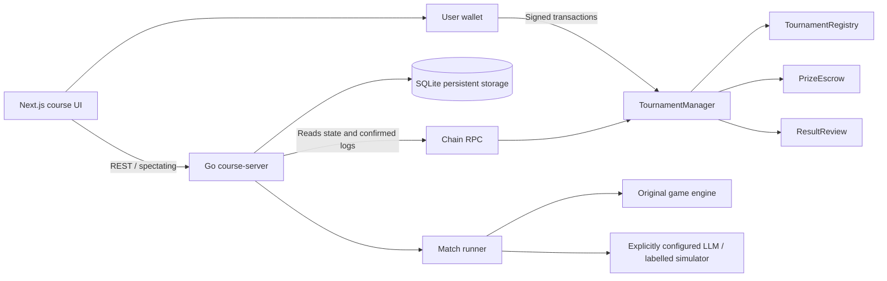
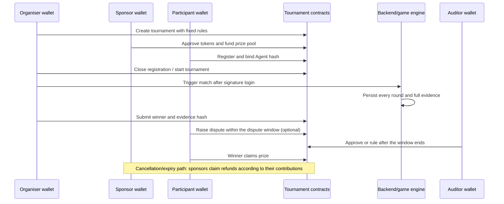
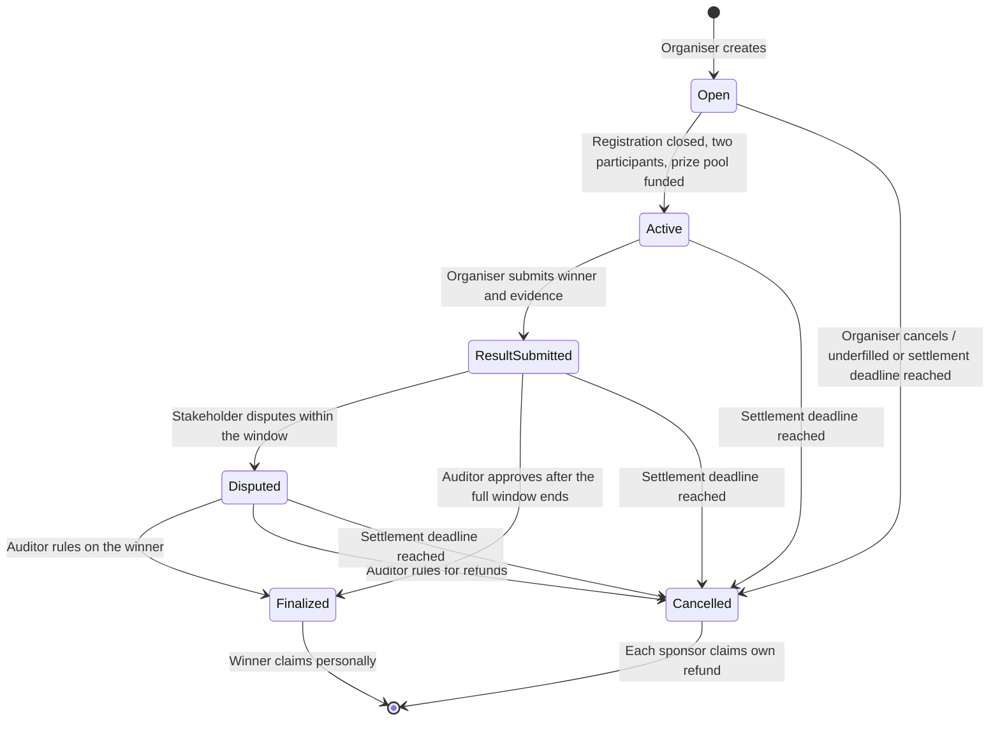
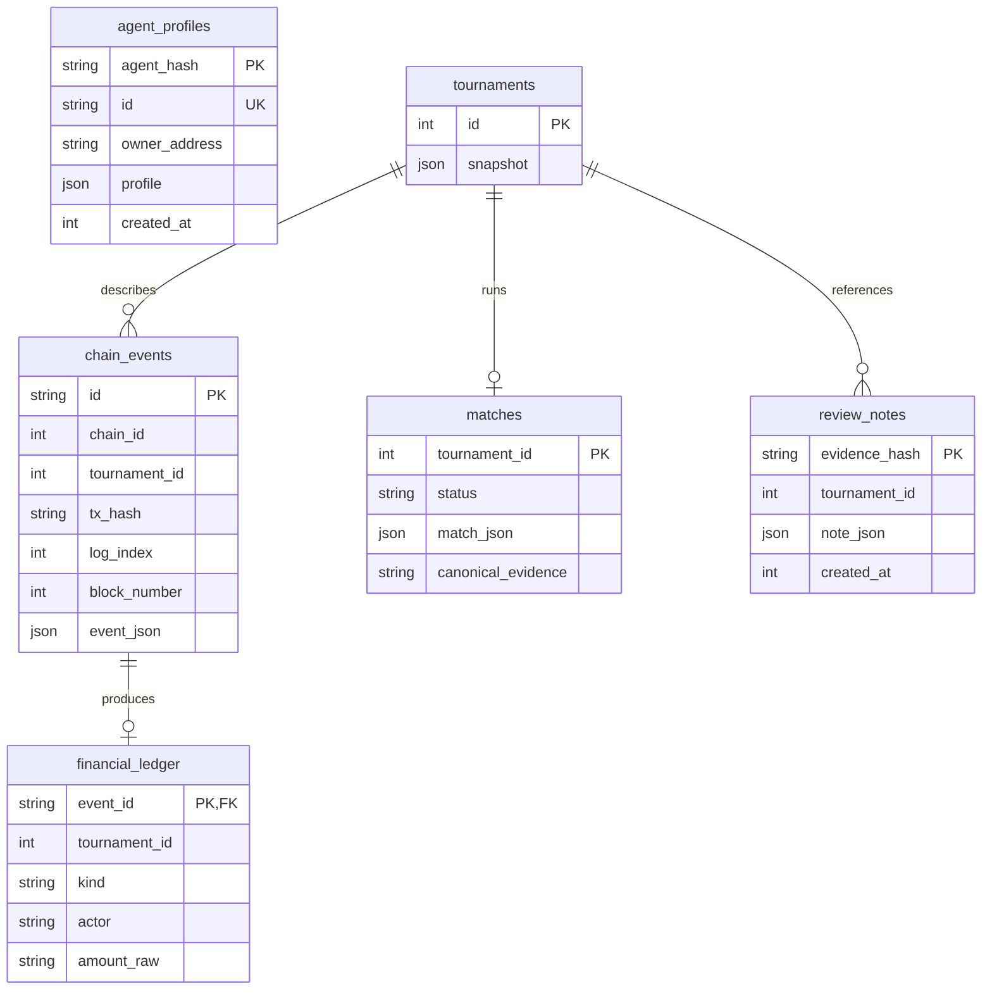
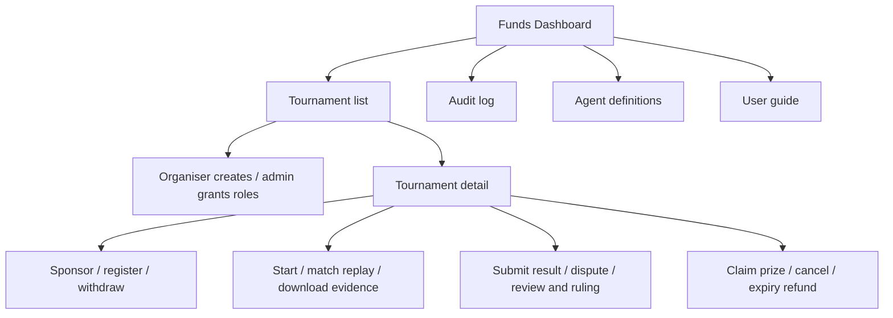

# Course Edition Architecture and Design Decisions

## System Boundaries

Contract interfaces and the final status enum are described in [CONTRACT.md](CONTRACT.md). Backend response formats are described in [API.md](API.md).

## ADR-001: On-chain State as the Source of Truth for Funds

**Context:** The hackathon edition mixed in-memory bets/votes with on-chain funds; a missing frontend callback or a server restart could cause discrepancies.

**Decision:** Wallets call the contracts directly, and the backend reads the contracts and confirmed events. An HTTP request cannot declare something "paid". The index database is only a rebuildable query view.

**Cost:** Users bear gas and confirmation waits; RPC failures must be presented clearly. On-chain data cannot replace off-chain profiles, complete match records or user testing.

## ADR-002: Add a Tournament Domain, Keep the Game Engine

**Context:** The original backend was organised around spectator betting, AC balances and PvE deposits. Simply renaming matches to tournaments would inherit fund rules that do not apply.

**Decision:** The course service entry point is `backend/cmd/course-server`, and the new domain lives in `backend/internal/tournament`; `engine` and `agent` are reused, and the legacy fund interfaces are isolated. The old code and historical documents can serve as a learning reference.

**Cost:** The old and new entry points must be clearly labelled; the default startup, deployment and frontend navigation all point to the course edition, and old contract addresses must not be mixed in.

## ADR-003: Sponsored Prize Pool and Pull Payment

**Decision:** Registration is free, and two participants compete for one winner. Funds are held in escrow first, and the winner claims them personally after review is complete; on cancellation, each sponsor claims their own refund. There is currently no platform fee.

**Rationale:** Prize payment, sponsor refunds and result disputes form a clear business loop. Per-person claiming prevents a single failed recipient in a batch payment from blocking all users.

**Security requirements:** An independent ledger per tournament and per funder, state updated before transfer, double claiming prohibited, and use of SafeERC20 and reentrancy protection. Token behaviour is validated against the amount actually received, and test tokens are clearly distinguished from real assets.

## ADR-004: Independent Review and Timeout Exit

**Decision:** The auditor and deadlines are fixed at creation, and the organiser submits a complete evidence hash; only after the dispute window can the auditor approve or rule. Tournaments not completed by the final deadline may be cancelled and refunded according to the rules.

**Limitations:** A hash proves that a record has not changed since it was submitted; it does not prove that the record was genuine in the first place, nor that the prompts were fair. Public rules, independent review and a replayable action log are needed.

## ADR-005: Immutable Agent Definitions

**Decision:** The backend stores wallet-owned Agent name/prompt definitions and computes the Keccak-256 of the canonical JSON. At registration this hash is written into the tournament; at run time it is used to locate and verify the definition, and the evidence contains a snapshot of the definition.

**Rationale:** This prevents prompts from being secretly swapped after registration, without permanently writing long prompts on-chain. The course edition shares a model interface explicitly configured on the server and does not store users' API keys.

## ADR-006: Single-instance SQLite and Durable Jobs

**Decision:** This round keeps the familiar SQLite, with appropriate concurrency and durability settings enabled; amounts are stored as decimal integer strings to avoid floating-point loss. The tournament index, nonces, run jobs, round records and evidence are all persisted to disk.

**Boundary:** A single instance with a persistent disk is sufficient for the course demo. Before horizontal scaling, the database and job scheduling should be migrated; adding API container replicas alone does not justify a claim of scalability.

## ADR-007: Verification Evidence First

**Decision:** The repository provides a deterministic local-chain demo, unit/integration tests, gas measurements and CI. A simulated chain/simulated LLM must be labelled; public deployment and user evaluation keep separate evidence of actual execution.

**Rationale:** "The code exists", "it compiles", "the local flow passes" and "the public deployment works" are four different conclusions, and the report must record each separately.

## Main Process

## State Machine

A match can only be started after the registration deadline, and it must leave the full time for result review; registration cannot be closed early. The designated auditor cannot organise, participate in or sponsor that tournament. Roles are re-checked at the time of each operation; if the organiser/auditor has their role revoked or becomes unreachable, anyone can still trigger refunds after the timeout. The administrator can revoke roles but cannot directly withdraw the prize pool.

## Data Model

Apart from the foreign key on `financial_ledger.event_id`, the tournament relationships in the diagram are mainly domain-logic relationships. Tournament snapshots, Agent status and complete rounds are stored in versioned JSON; the Agent registration link is expressed by `participant_agents` in the snapshot pointing to `agent_hash`. In addition, `login_nonces`, `database_identity`, `index_cursors` and `index_checkpoints` support authentication and synchronisation.

Rebuildable from the chain: tournament projections, chain events, financial ledger and index cursors. Must be backed up: Agent definitions, match actions/evidence and review reasons. On-chain hashes cannot recover lost original files.

## Confirmation, Idempotency and Recovery

The indexing target is `head - confirmations`, with at most 2,000 blocks per batch. Tournament snapshots and logs are pinned to the same last block of the batch, and the unique event key includes the chain ID, transaction hash and log index. The batch's events, ledger, snapshots, next-block cursor and checkpoint are committed in a single SQLite transaction; on failure the whole batch is rolled back.

The detail page can read the latest chain state, labelled `confirmed:false`; this query does not overwrite the confirmed projection. The funds Dashboard aggregates only confirmed events. If the block hash of a saved checkpoint changes, indexing is paused and `/ready` fails; after inspection, operators rebuild the projection from the deployment block. The course edition does not claim to support automatic handling of reorganisations of arbitrary depth.

One database is bound to one chain ID / Manager / deployment block. Changing the deployment requires changing the database; restoring a backup of the same deployment cannot change its identity. The match saves state every round; after a service restart, unfinished jobs can be resumed by the organiser; completed evidence cannot be overwritten by "running again".

## UI and Task Entry Points

Buttons that require a wallet check the network, identity and on-chain state together; gas is estimated before wallet submission, and the receipt is awaited after submission. Indexing delays, pending transactions, user-rejected signatures, contract failures and RPC failures each have distinct feedback; frontend display logic does not replace contract validation.
