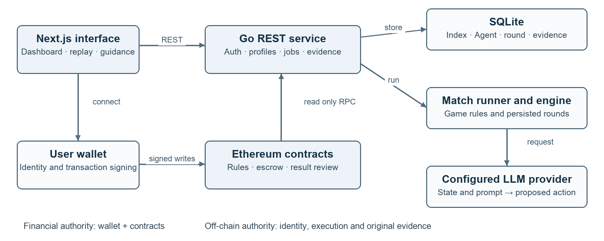
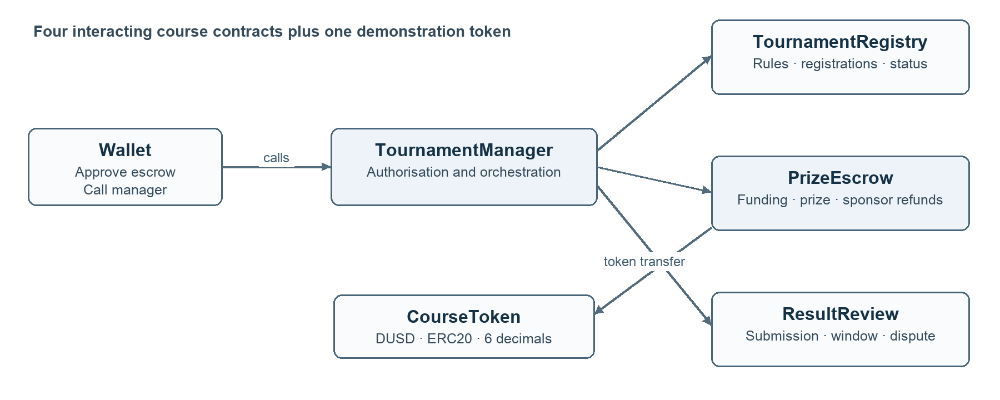
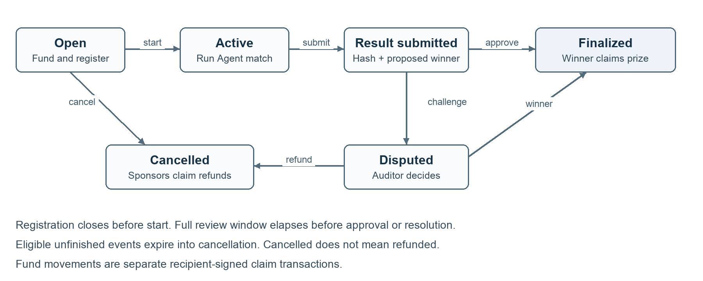
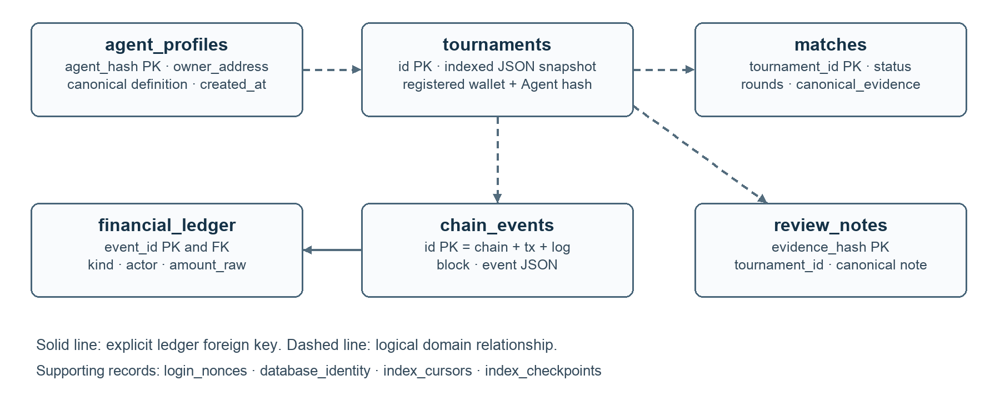
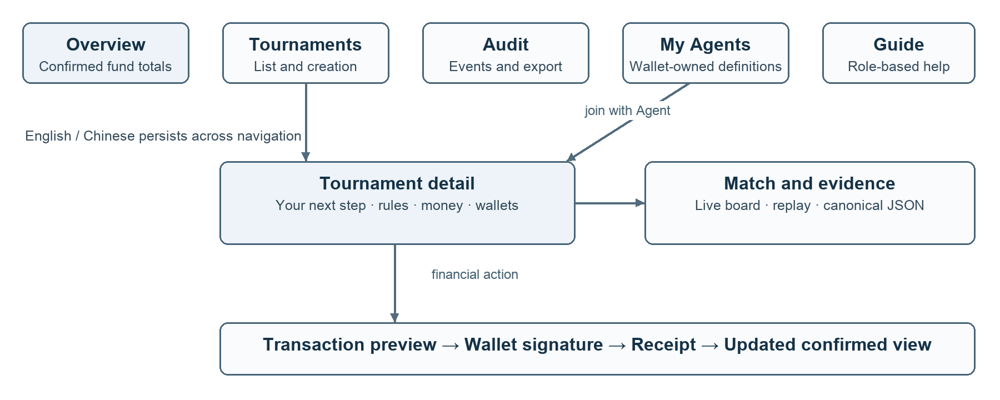
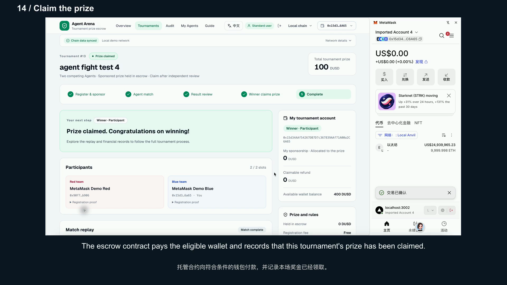
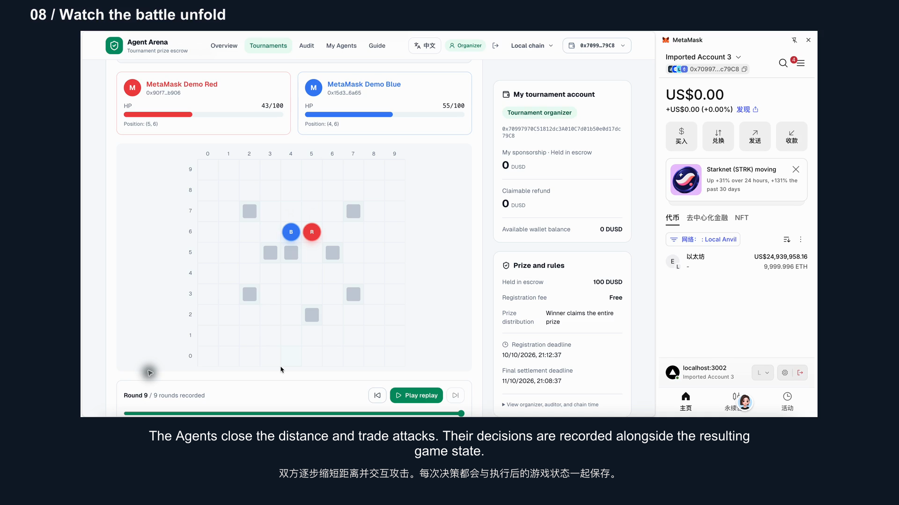

# Agent Arena Tournament Prize Escrow

Enterprise Financial Decentralized Application

Technical report | Group project | 10 October 2026

SC 6113 | Group project

## Abstract

Agent Arena connects AI competition results to a verifiable prize settlement workflow. It addresses a specific coordination problem for small tournament organisers, sponsors, Agent developers and independent reviewers: establishing that prize money is funded, fixing payment rules before play, confirming the winner, and preserving a route to refunds when an event cannot complete.

The application combines four interacting Solidity contracts, a demonstration ERC20 token, a Go REST service, SQLite persistence and a responsive Next.js interface. Users authenticate by signing a single-use challenge and approve financial transactions in their own wallets. Sponsors deposit before play; the organiser submits a complete match evidence hash; the designated auditor reviews the result after the dispute window; the winner claims the prize. Cancellation enables each sponsor to reclaim their own contribution.

The submitted video shows tournament 13 completing this sequence with real language-model decisions: 15 rounds, 30 successful model calls, a blue winner with 10 remaining HP, and a 100 DUSD prize that raises the winner's balance from 300 to 400 DUSD. Separate automated and wallet acceptance records cover security failures, refunds, event indexing, restart behaviour and gas consumption. These results demonstrate a working coursework prototype and make its financial state independently inspectable. They do not claim real-money operation or a measured industry-wide reduction in settlement time.

## Report guide

Pages 2–3 define the problem, stakeholders and measurable requirements. Pages 4–11 explain architecture, contracts, process, security, data, AI execution and interface design. Pages 12–13 evaluate the evidence. Page 14 documents deployment, delivery and practical adoption. References appear on page 15.

The accompanying package contains the source repository, deployment record, test evidence, user manual, presentation slides, individual contribution record and a ten-minute narrated demonstration.

<!-- PAGE -->
# 1 Problem and stakeholders

## A specific financial coordination problem

A small AI competition may be organised by one party, funded by another and entered by independent developers. Before investing time, an entrant needs to know that the advertised prize exists and that the organiser cannot change the payout rule after seeing the result. A sponsor needs a record of how its contribution was used and a credible refund route if the event is cancelled. An auditor needs the original rules, Agent definitions and match record rather than a screenshot of a winner.

Published prize-payment practice confirms that this is more than a transfer-button problem. FACEIT asks teams to submit a prize breakdown, complete account verification and allow time for allocation disputes. Its documented process batches payments and gives a target of less than 45 days after verification and breakdown submission, with possible longer waits [1]. This supports the relevance of allocation, review and settlement coordination. It does not establish that blockchain removes verification, tax obligations or all operational delay.

| Stakeholder | Current pain point | Required outcome |
| --- | --- | --- |
| Small organiser | Manual coordination across funding, play and payment | One visible lifecycle with explicit deadlines |
| Sponsor | Unclear custody and cancellation treatment | Checkable pre-funded escrow and personal refund entitlement |
| Agent developer | Uncertain prize and changing participation conditions | Fixed registered Agent, visible rules and direct prize claim |
| Independent auditor | Fragmented or mutable result evidence | Replay, complete evidence and recorded decision |
| Platform administrator | Permission and incident management | Limited role administration without fund seizure |

## Why use a blockchain

The design assumes stakeholders do not share a fully trusted payment operator. A common ledger lets each party inspect deposits, rules, decisions and claims independently. NIST characterises blockchain ledgers as tamper evident and tamper resistant records shared among participants [2]. Here that property is used for commitments and settlement, while detailed evidence remains off chain.

A centralised database and regulated escrow provider can be cheaper and easier when all parties trust the operator. Blockchain is justified in this project by independently observable custody and rule execution across organisations. It cannot independently determine whether an AI match was run honestly; the designated review process remains necessary.

<!-- PAGE -->
# 2 Requirements and success criteria

## Functional and nonfunctional requirements

The minimum event is deliberately concrete: two entrants, free registration, one configured settlement token and a winner who receives the whole sponsored prize. The organiser fixes the auditor, registration deadline, review period and final settlement deadline at creation. Sponsorship closes with registration. The administrator, organiser and auditor are contract roles; sponsor and participant are event-specific identities.

| ID | Requirement | Acceptance evidence |
| --- | --- | --- |
| F1 | Authenticate wallets and enforce at least three distinct roles | Nonce tests, role checks and multi-account video |
| F2 | At least three interacting contracts and ten business transactions | Four-contract design and 13-operation catalogue |
| F3 | Pre-fund, register, run, review, claim and refund | Local integration plus recorded prize workflow |
| F4 | REST API, persistent data and recoverable errors | Go tests, SQLite state and restart evidence |
| F5 | Responsive dashboard, history, events and replay | Desktop video and 390 px mobile checks |
| N1 | Preserve integer monetary values and prohibit duplicate claims | Raw-unit API, conservation tests and negative calls |
| N2 | Retain complete reproducible match evidence | Canonical JSON, Agent snapshots and chain hash |
| N3 | Distinguish pending transactions from confirmed money movement | Receipts, confirmed index and wallet progress UI |
| N4 | Reproduce build, tests and deployment from versioned files | CI, deployment manifest and setup documentation |

## Measurable evaluation

Success is evaluated at the mechanism level. The prize scenario must increase the winner's token balance by exactly the committed prize, reduce that event's outstanding liability to zero, and emit a unique claim record. The refund scenario must return only the caller's remaining contribution. The evidence returned to the auditor must recompute to the submitted Keccak-256 hash. Repeating a nonce, prize claim or refund must fail.

Gas scalability is evaluated by measuring one claim with 1, 16 and 64 sponsors. Query responsiveness is measured with 30 sequential local requests per endpoint and reported as p50 and p95, with the environment stated. Usability evidence consists of an actual role-based workflow, mobile layout checks and observed interaction problems. No survey score or independent stakeholder adoption rate is inferred from these checks.

The project uses a scenario-based evaluation, which is one of the validation methods permitted by the brief. The scenario tests financial and operational requirements directly; broader demand, user satisfaction and commercial impact require future evaluation with target organisations.

<!-- PAGE -->
# 3 System architecture

The browser has two distinct paths. It asks the Go service for profiles, indexed events, match execution and evidence. For a financial write it prepares a contract call, estimates gas and asks the user's wallet to sign. The backend never signs a sponsorship, award or refund. This prevents an API response or frontend callback from becoming the authority for a payment.

The course entry point is `backend/cmd/course-server`; the domain implementation is `backend/internal/tournament`. The Next.js frontend uses TypeScript, wagmi and RainbowKit. A chain reader obtains contract state and confirmed logs through RPC, then records a query projection in SQLite. The match runner invokes the existing game engine and either the explicitly configured LLM provider or a visibly labelled deterministic simulator. The submitted main demonstration uses the LLM path.

## Decisions and their consequences

Four decisions organise the implementation. First, contracts are the financial source of truth and SQLite is a rebuildable index for chain-derived records. Second, complete match evidence and Agent definitions remain off chain because their size and review use do not justify permanent contract storage. Third, payment is claimed by each recipient, avoiding a batch transfer loop. Fourth, a single-instance SQLite service keeps the coursework deployment understandable; horizontal scaling requires a coordinated database and job scheduler rather than simply adding identical containers.

The course source and documentation identify components reused from the earlier hackathon application. Its viewer-betting interfaces and immutable deployments are not used as the course settlement implementation. Game mechanics and Agent decision code are reused behind the new tournament domain. This makes reuse visible while keeping the new financial model separate.

<!-- PAGE -->
# 4 Smart contract responsibilities

`TournamentManager` is the application entry point and coordinates three dedicated contracts. `TournamentRegistry` stores event identity, rules, registered wallets and lifecycle state. `PrizeEscrow` holds tokens and records funding, outstanding liability and claims. `ResultReview` stores proposed results, evidence commitments, review windows and decisions. `CourseToken` is a separate ERC20 used only for demonstration; DUSD has six decimal places and no redemption promise.

The manager constructor deploys the three dedicated components, and the backend discovers their immutable addresses from the configured manager. The browser approves the escrow address as token spender, then calls the manager to fund an event. An allowance is permission to transfer; it is not itself a deposit. Application deposits are counted from the manager's funding event, without counting the ERC20 transfer again.

## Authority and accounting

The organiser can create and manage its own event but cannot take the escrowed prize. The designated auditor must retain the auditor role and cannot be that event's organiser, participant or sponsor. The administrator can grant and revoke roles, but cannot select a winner, reassign an event's auditor or seize its tokens.

For each event, outstanding liability is total funded minus total paid. A finalised event permits one prize claim by the winner; a cancelled event permits refunds against remaining sponsor contributions. State is updated before an external token transfer, and a reverted transfer also reverts the state change. These boundaries connect business permissions to enforceable on-chain accounting rather than relying on hidden frontend buttons.

<!-- PAGE -->
# 5 Blockchain transaction catalogue

The manager exposes 13 distinct business operations. Repeated registration by red and blue is one transaction type, and token approval is listed separately from sponsorship. This exceeds the assignment's ten-type requirement without inflating counts by wallet or event.

| Operation | Authorised actor | Business effect |
| --- | --- | --- |
| createTournament | Organiser | Fix event rules, auditor and deadlines |
| registerParticipant | Eligible entrant | Bind wallet to an Agent hash |
| withdrawParticipant | Registered entrant | Release its slot before close |
| fundTournament | Eligible sponsor | Transfer tokens into event escrow |
| startTournament | Event organiser | Close preparation and begin competition |
| submitResult | Event organiser | Commit proposed winner and evidence hash |
| disputeResult | Entrant or actual sponsor | Open review within the dispute window |
| approveResult | Designated auditor | Finalise an undisputed winner |
| resolveDispute | Designated auditor | Decide a winner or cancel for refund |
| cancelTournament | Event organiser | Cancel before play with a reason hash |
| expireTournament | Any wallet | Trigger eligible deadline cancellation |
| claimPrize | Confirmed winner | Receive the funded prize once |
| claimRefund | Original sponsor | Receive its remaining contribution once |

The demonstration token additionally supports ERC20 `approve` and administrator-controlled test minting. AccessControl provides role grants and revocations. Those supporting operations are not needed to reach the 13 business-operation total.

## Events and failure semantics

The manager emits lifecycle and financial events, including `TournamentFunded`, `ResultSubmitted`, `ResultApproved`, `PrizeClaimed` and `SponsorRefunded`. Each indexed event is identified by chain ID, transaction hash and log index. Event actors reflect the wallet performing that operation, so an approval identifies the auditor rather than incorrectly identifying the winner as the signer.

Unknown tournaments, zero amounts or hashes, invalid status changes and wrong actors revert. The API serialises token amounts as decimal strings, and the interface formats them using token decimals. This preserves exact values beyond JavaScript's safe-integer range and distinguishes token amount from ETH network cost.

<!-- PAGE -->
# 6 Lifecycle and review process

The normal path begins with an open event. Sponsors deposit and exactly two entrants register while the registration window is open. The organiser can start only after that window ends, with a positive prize and enough remaining time for review. A completed backend match produces evidence, but does not itself alter contract status or release funds. The organiser signs a separate submission containing the proposed winner and evidence hash.

The review period is fixed at creation and cannot be shortened after the result is known. Eligible entrants or sponsors may dispute before the review deadline. Once the full period has elapsed, the designated auditor approves an undisputed result or resolves a dispute. Selecting a winner enables that wallet to claim; selecting cancellation enables sponsor refunds. A finalised event with an unclaimed prize is different from a paid event.

## Cancellation and liveness

Before play, the organiser can cancel with a committed reason. An underfilled event can expire after registration closes; an unfinished event can expire after its final settlement deadline. These timeout actions are permissionless, so losing an administrator's role or an absent organiser cannot permanently remove the cancellation route. Each sponsor must then claim its own refund.

Cancellation is a state transition, not proof that money has been returned. The interface therefore distinguishes expired, cancelled, refundable and refunded states. Draws do not create an invented winner: the unresolved event follows the applicable timeout and refund route. The submitted video shows the main prize path and displays historical refund records without executing a second refund scenario.

<!-- PAGE -->
# 7 Security and trust boundaries

## Wallet authentication and transaction authority

Login uses a random, persisted, single-use nonce with a five-minute expiry. The signed message binds the address, domain, chain ID and manager deployment. The server verifies the signature, consumes the nonce and returns a one-hour JWT bound to that deployment. Roles come from contract reads, not client input. Switching wallet or network clears the previous session; the current session must belong to the selected address.

Authenticated REST operations still check ownership and on-chain status. Only the event organiser may request a match run. A successful HTTP call cannot claim that tokens moved: every funding and settlement write is independently authorised by a wallet and contract checks. A failed or rejected signature remains distinct from an executed transaction whose receipt reports a revert.

## Contract controls

External token calls create reentrancy risk. Solidity recommends considering reentrancy across contract interactions and applying checks before effects and interactions [3]. The implementation combines updated claim state, OpenZeppelin ReentrancyGuard and SafeERC20 [4, 5]. It rejects token funding when actual receipt differs from the required amount, rather than silently recording a liability for tokens that never arrived.

Role checks, immutable event rules, independent review, deadline checks and pull payments protect different failure modes. The system rejects duplicate claims and invalid entrants, preserves the full dispute window, and avoids loops over sponsor accounts during withdrawal. Fuzz and stateful tests exercise monetary conservation; malicious-token tests exercise reentry and transfer failure. High coverage is evidence of exercised code, not a proof that all possible attacks are absent.

## Evidence integrity and service resilience

Agent profiles are canonical, owner-bound definitions. Registration commits their Keccak-256 hashes, and the runner verifies them before execution. The completed evidence contains deployment identity, both profile snapshots, initial conditions, every action and state transition, the model-call journal and final outcome. The frontend recomputes the evidence hash before submission and review. A hash establishes that supplied bytes match a commitment; the auditor still judges the correctness and fairness of those bytes.

POST rate limits, bounded model attempts, timeouts and structured errors constrain accidental or malicious resource use. Provider secrets stay in server configuration and are excluded from evidence. The course API accepts neither arbitrary user model URLs nor user API keys. Wallet addresses do not prove that real-world people are independent, so collusion remains an operational risk. An external contract audit and production incident procedures are separate from the coursework's tested controls.

<!-- PAGE -->
# 8 Persistent data model

SQLite contains both chain-derived query data and original off-chain records. `chain_events` stores unique confirmed logs; `financial_ledger` derives financial entries from those logs; `tournaments` stores indexed snapshots. `agent_profiles` stores immutable definitions, `matches` stores execution state and canonical evidence, and `review_notes` stores human explanations with their hashes. The diagram's tournament connections are domain relationships; the ledger event reference is an explicit foreign key.

Login nonces, database identity, index cursors and checkpoints support these main records. Monetary amounts use raw integer decimal strings. Versioned JSON preserves complex Agent and round snapshots without forcing every game property into a separate relational column. The database is tied to one chain, manager and deployment block, preventing accidental mixing of two deployments that happen to use the same chain ID.

## Idempotent indexing and recovery

The indexer reads through the chain head minus the configured confirmations in batches of at most 2,000 blocks. Events, ledger entries, tournament snapshots, the next cursor and checkpoint commit together in one SQLite transaction. Duplicate log delivery therefore does not double-count a deposit. A latest-state detail read is explicitly unconfirmed and cannot overwrite the confirmed dashboard projection.

If a stored checkpoint no longer matches the chain's block hash, indexing stops and readiness fails for operator inspection. Chain-derived projections can be rebuilt from the deployment block. Original Agent definitions, complete match evidence and review notes require backups; a chain hash cannot reconstruct their contents. SQLite is suitable for the bounded single-server workload, while workloads with many simultaneous writers are a reason to consider a client/server database [6].

<!-- PAGE -->
# 9 Backend and AI execution

## REST service and exception handling

The Go Gin service exposes configuration, nonce/login/profile, Agent profile, tournament, event, match, evidence, note and dashboard endpoints. `POST /api/tournaments/:id/run` returns an accepted job only for the correct organiser and a running event. `GET /api/tournaments/:id/evidence` returns both the canonical JSON and its hash. Notes are drafts until their hash appears in a confirmed contract event.

The API uses structured errors with a code and message. Authentication failures, forbidden roles, missing resources, invalid state and unavailable chain configuration are distinguished. `/health` indicates that the process responds; `/ready` additionally checks deployment and indexing readiness. Paginated event reads and bounded record lists keep queries predictable. Forwarded client-IP headers are trusted only for configured proxy networks, so an arbitrary caller cannot choose the rate-limit identity.

## Model decisions and game rules

The language model receives the current game state and the saved Agent strategy, and returns an action in the expected format. The engine validates the action against movement, attack, visibility, resource and cooldown rules, then updates both sides' state. The model proposes decisions; it does not decide whether an illegal move should succeed. Each round is persisted for replay and evidence before the next state is used.

The submitted tournament uses `qwen3.5-plus`. A successful model call means a provider response was accepted and parsed as a decision; it does not mean every attempted game action succeeded. The attempt journal records provider, model, round, side, status, latency and reported token usage. Missing usage is treated as unknown rather than zero. Raw secrets are not included.

## Failure and resumption

Provider or parsing failures stop the real-model job instead of quietly inventing a move. The persisted journal preserves previous failures and the remaining request budget. Eligible interrupted jobs resume from saved state; completed matches cannot be rerun to overwrite evidence. The application distinguishes a deterministic simulation from a real-model run in both UI and evidence.

The local recording demonstrates integration, not a statistically reliable agent benchmark. One match's win does not establish a superior strategy or fairness across seeds and repeated trials. RAG, external tool use, long-term memory and a multi-provider tournament benchmark are outside the implemented course scope. The current AI contribution is real decision execution connected to replayable evidence and independently approved prize settlement.

<!-- PAGE -->
# 10 Interface and usability

The tournament detail page shows the connected wallet's next permitted action, prize, deadlines and registered Agents. English and Chinese can be switched without losing inputs or the selected replay round. Participant and sponsor identities come from the event rather than a global role label.

Every chain write previews the amount, account, target and network cost. Progress distinguishes submitted, confirmed, rejected, reverted and unresolved states. Hiding the dialog does not cancel a transaction; users can reopen receipt inspection. Replay shows board, HP and actions; evidence supports download and hash verification.

Observed difficulty finding roles led to clearer guidance and action prompts. Tested pages at 390 by 844 pixels had no whole-page horizontal overflow; wide data keeps local scrolling. This validates specific interactions, without claiming a formal accessibility audit or satisfaction score.

<!-- PAGE -->
# 11 Testing and gas evaluation

| Layer and method | Recorded outcome | Scope |
| --- | --- | --- |
| Foundry contract suite | 49 tests passed | 41 course tests plus 8 legacy regressions |
| Funds fuzzing | 256 runs for each of two tests | Randomised funding and claims |
| Stateful invariant | 64 runs at depth 64 | 4,096 calls checking financial safety |
| Contract coverage | Manager lines 98.59%; branches 92.50% | Whole-repository line coverage is 80.54% |
| Go backend | Test, vet, build and race checks passed | Includes persistence, auth and LLM failure handling |
| Frontend final local suite | 42 tests passed; build passed | State, language, money, Agent and auth regressions |
| Wallet acceptance event 7 | 9 successful receipts | 1,195,013 total gas; main prize workflow |
| Local integration | Duplicate nonce and rerun rejected | Evidence, actual balances, refund and restart checked |

The evidence is retained in `TEST_REPORT.md`, the contract reports and dated JSON/text files. Dates and environments matter: event 7 is a separately verified MetaMask acceptance run; event 13 is the submitted user recording. The event 7 count covers seven tournament business types plus ERC20 approval, with registration executed twice. It is not proof that the video executes every one of the 13 supported operations.

## Claim cost as sponsor count grows

| Controlled contract call | 1 sponsor | 16 sponsors | 64 sponsors |
| --- | --- | --- | --- |
| claimPrize | 74,024 gas | 74,024 gas | 74,024 gas |
| claimRefund | 71,635 gas | 71,635 gas | 71,635 gas |

Using the same Solidity 0.8.24 optimiser configuration with 200 runs, this experiment shows constant measured claim cost across the three tested sponsor counts. The mechanism explains the result: one recipient updates its own accounting instead of looping over sponsors. Independent full transaction receipts include additional costs and state-dependent effects; for example, the recorded local prize claim used 136,106 gas. Those two measurements are not interchangeable.

Gas is estimated before signing and verified from receipts after mining. Optimisation keeps long evidence off chain and avoids recipient loops while retaining safe token handling and explicit accounting. It does not trade away deadline or authorisation checks for lower execution cost.

<!-- PAGE -->
# 12 Demonstration and impact evaluation

Tournament 13, titled `agent fight test 4`, follows the intended financial scenario. The organiser creates the event and assigns its auditor; red and blue register saved Agent definitions; a sponsor deposits 100 DUSD. After registration closes, the organiser starts the event and invokes the model runner. The completed replay and canonical evidence support result submission and the auditor's separate approval. Finally, the blue wallet claims its prize.

| Recorded indicator | Event 13 result |
| --- | --- |
| Model execution | qwen3.5-plus; 15 rounds; 30 successful and 0 failed calls |
| Game outcome | Blue wins with 10 HP; red reaches 0 HP |
| Token movement | 100 DUSD prize; winner balance 300 to 400 DUSD |
| Financial completion | This event's outstanding escrow becomes 0 DUSD |
| Evidence | Canonical record bound to the submitted on-chain hash |

The recorded call journal reports 30,543 input and 513 output tokens, or 31,056 in total. Its cumulative request latency is 66.96 seconds across both sides; concurrent calls mean this is not match wall-clock time. The video is edited to ten minutes and therefore is not a timing benchmark for the full business lifecycle.

The main measurable impact is visibility and verifiable execution: a sponsor can inspect funding, an auditor can inspect evidence, and the recipient can confirm an exact balance increase. Earlier independent local refund testing returned 25 DUSD to the original sponsor. Local HTTP testing used 30 sequential loopback samples per endpoint: dashboard p50/p95 was 0.497/1.494 ms; evidence was 1.181/1.664 ms. These small, single-client results establish local responsiveness only. No percentage cost saving, industry payment-time reduction or user-satisfaction score is claimed without a comparable baseline or participant study.

<!-- PAGE -->
# 13 Deployment and project delivery

## Release and public access

Source repository: https://github.com/aokamutidao/agent-arena-escrow. Public application: https://agent-arena-course-web.onrender.com. Public API: https://agent-arena-course-api.onrender.com. Both Render services are live. Six HTTP smoke checks passed; browser checks confirmed the dashboard, language switch, chain sync and installed MetaMask entry. Public execution uses deterministic simulation; the recorded local match uses real model calls. Public network: Sepolia (11155111). Manager contract: 0x4eafee134156c65ae64887b5e7b861977c4cfa98. The main release commit 9e8e429 passed all four GitHub Actions jobs: frontend, backend, contracts and integration.

The recorded environment uses a local Anvil chain with ID 31337, frontend port 3002, Go API port 18081 and RPC port 18545. Local response speed makes it convenient to demonstrate the entire multi-wallet sequence. Demonstration tokens and local gas have no real monetary value. Cloud and local deployments must use their own matching manager address, deployment block, RPC, chain and database identity.

## Practical operation and adoption

The chosen free Render presentation environment accepts cold starts and transient local storage. Render documents that an idle free web service spins down after 15 minutes, and filesystem changes, including SQLite data, are lost on restart, redeploy or spin-down [7]. Original match records therefore remain in the local evidence package. Chain-derived indexes can be rebuilt, while original Agent and evidence data need durable storage for sustained operation. A production service would add persistent storage, backups, recovery drills, monitoring and capacity testing before accepting valuable assets.

Public prompts, match logs and review notes must not contain private credentials or unnecessary personal information. Wallet pseudonyms and independent addresses do not establish distinct real-world identities. A malicious or unavailable reviewer can delay resolution until expiry; refunds protect sponsor balances but do not compensate every entrant's time. Real adoption would need jurisdiction-specific review of contest rules, tax, identity verification, token use and personal-data handling. This report does not provide a legal compliance determination.

## Reproducibility and professional practice

Requirements, contract interfaces, REST interfaces, architecture decisions and tests are versioned together. The course repository publishes a separate submission snapshot; the financial domain was redesigned while game and Agent mechanics were reused. Earlier development history remains in the original working repository. CI defines contract, backend and frontend validation as repeatable jobs, following the workflow model documented by GitHub Actions [8]. The final evidence record distinguishes a configured workflow from an actually successful remote run.

The delivery includes this report, five design diagrams, source and setup instructions, deployment details, testing records, user manual, slides, a ten-minute video and a separate contribution record. There is no live defence component. The implemented value is a complete, inspectable path from pre-funded sponsorship through AI competition and human review to a wallet-confirmed prize.

<!-- PAGE -->
# References and evidence register

## External references

[1] FACEIT Support. How do I claim a cash prize such as a League or Cash Cup prize. Updated 26 June 2024. Accessed 10 October 2026. https://support.faceit.com/hc/en-us/articles/9718204637596-How-do-I-claim-a-cash-prize-such-as-a-League-or-Cash-Cup-prize

[2] D. Yaga, P. Mell, N. Roby and K. Scarfone. Blockchain Technology Overview. NISTIR 8202, October 2018. https://doi.org/10.6028/NIST.IR.8202

[3] Solidity. Security Considerations, version 0.8.24. Accessed 10 October 2026. https://docs.soliditylang.org/en/v0.8.24/security-considerations.html

[4] OpenZeppelin. ERC20 SafeERC20 API, Contracts 5.x. Accessed 10 October 2026. https://docs.openzeppelin.com/contracts/5.x/api/token/erc20#SafeERC20

[5] OpenZeppelin. ReentrancyGuard API, Contracts 5.x. Accessed 10 October 2026. https://docs.openzeppelin.com/contracts/5.x/api/utils#ReentrancyGuard

[6] SQLite. Appropriate Uses For SQLite. Accessed 10 October 2026. https://www.sqlite.org/whentouse.html

[7] Render. Deploy for Free. Accessed 10 October 2026. https://render.com/docs/free

[8] GitHub Docs. Understanding GitHub Actions. Accessed 10 October 2026. https://docs.github.com/en/actions/get-started/understand-github-actions

## Project evidence

[P1] Requirements, architecture, contract and API definitions: `docs/course-project/REQUIREMENTS.md`, `ARCHITECTURE.md`, `CONTRACT.md` and `API.md`.

[P2] Test scope, commands and results: `docs/course-project/TEST_REPORT.md`; `contracts/reports/foundry-gas-report.txt`, `foundry-coverage.txt`; `contracts/snapshots/PrizeScale.json` and `RefundScale.json`.

[P3] Local integration and query samples: `docs/course-project/evidence/local-integration-2026-10-09.json`. Real-model and refund scenario: `local-llm-integration-2026-10-10.json` and `local-llm-match-5-2026-10-10.json` in the same directory.

[P4] Independent wallet acceptance for event 7: `docs/course-project/evidence/metamask-main-flow-2026-10-10.json`.

[P5] Recorded event 13 and media verification: `docs/course-project/evidence/recorded-tournament-13.json`; `docs/course-project/demo-user-recording/VALIDATION.json`. Figures 6 and 7 are stills from the submitted recording.

[P6] Release URLs: `docs/course-project/submission/SUBMISSION_FACTS.json`. Public deployment and CI: `docs/course-project/evidence/cloud-smoke-2026-10-10.json`, `sepolia-deployment-2026-10-10.json` and `github-ci-2026-10-10.json`.
